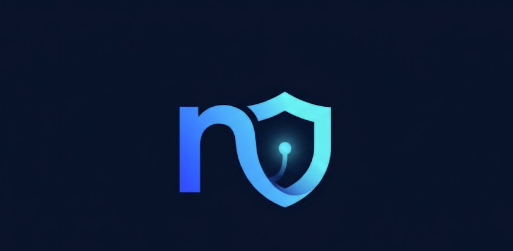
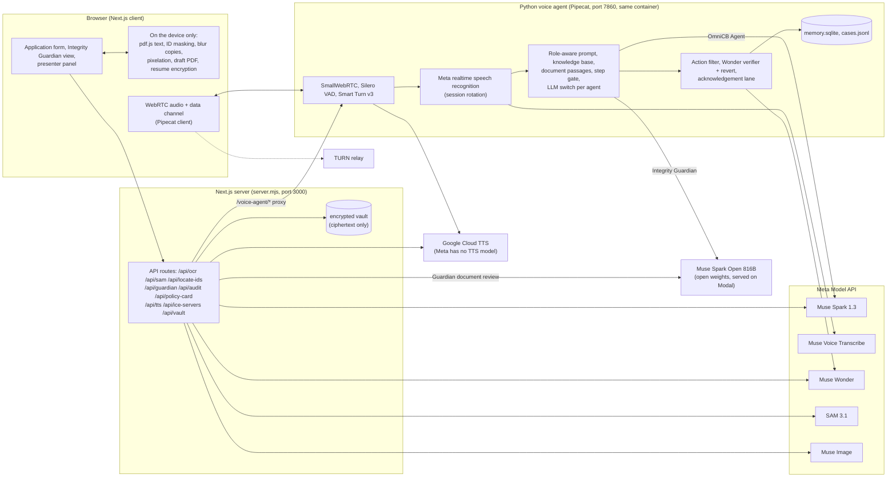

<p align="center"></p>

# CoverPilot

Buying term-life cover in India means a long form, identity documents that get photographed and forwarded, and a policy that most people sign without reading. CoverPilot is built for that customer: they talk and the form fills itself in English, Hindi or Marathi; their ID numbers never leave the browser; and a second, independent agent reads the proposed policy back to them, page by page, before they sign. In the demo it caught 7 of 7 planted problems in a sample policy and raised none on a correct one.

**Two voice agents on one Meta-powered runtime, for a term-life insurance application: one fills the form with the customer, the other checks the policy before they sign.**
*A verifiable agent: every action is typed and allow-listed, a second Meta model checks each one and a rejected one is reverted, deterministic code does the comparisons the model must not, and the browser confirms what actually changed.*
*Built for the Meta Global AI Developer Hackathon 2026, problem statement "Build for Your World".*

- **Live demo:** [coverpilot.veloxpro.in](https://coverpilot.veloxpro.in) (Chrome, microphone, sample documents only)
- **Demo video, intro + demo:** [youtube.com/watch?v=BRHOGpE4NCo](https://www.youtube.com/watch?v=BRHOGpE4NCo)
- **Demo video, demo only:** [youtube.com/watch?v=BRHOGpE4NCo&t=48](https://www.youtube.com/watch?v=BRHOGpE4NCo&t=48)
- **Pitch deck (5 slides):** [docs/CoverPilot-pitch.pdf](docs/CoverPilot-pitch.pdf) (problem, solution, model map, other uses)
- **Presenter / debug view:** [coverpilot.veloxpro.in/presenter](https://coverpilot.veloxpro.in/presenter) (the same app plus a live panel of the agent's internals: model calls and latency, knowledge-base chunks, turn timeline, Muse Wonder verdicts, customer memory)

> **Everything here is a demo.** The insurer (NexaSure), its policy documents, UIN, policy numbers and people are fictional. The sample documents are marked as such, the e-signature is a typed name and the payment moves no money. Nothing in this project is an offer of insurance, tax advice or medical advice. The demo build works on the bundled sample documents only (see [Demo build](#demo-build-and-own-files)).

## Contents

0. [For judges: three minutes with the live demo](#for-judges-three-minutes-with-the-live-demo)
1. [The problem, and how CoverPilot solves it](#the-problem-and-how-coverpilot-solves-it)
2. [What it does](#what-it-does)
3. [Measured](#measured)
4. [Architecture](#architecture)
5. [Meta models and what each one does](#meta-models-and-what-each-one-does)
6. [A verifiable agent, not a chatbot with RAG](#a-verifiable-agent-not-a-chatbot-with-rag)
7. [Privacy: what leaves the browser](#privacy-what-leaves-the-browser)
8. [Tech stack](#tech-stack)
9. [Repository layout](#repository-layout)
10. [Run it](#run-it)
11. [Configuration](#configuration)
12. [Deploy to a public host](#deploy-to-a-public-host)
13. [Testing](#testing)
14. [Built during the hackathon](#built-during-the-hackathon)
15. [Honest limits](#honest-limits)
16. [Other uses and future work](#other-uses-and-future-work)

## For judges: three minutes with the live demo

**Click path (about 90 seconds, Chrome, microphone allowed).** Open [coverpilot.veloxpro.in](https://coverpilot.veloxpro.in) → **Start a new policy** → **Accept and start co-browsing** → say *"use the sample documents"* and tap **Sample PAN Card**, **Masked Aadhaar**, **Salary Slip** when asked → say *"I am a non-smoker"* and press **Confirm** on the card that appears → at step 5 press **Review it with Integrity Guardian** → **Run Integrity Guardian** → ask it *"what is the grace period?"* To see it catch problems, go back to the opening screen, pick **Review a policy** and load **Sample proposed policy (with issues)**: seven findings, each with a page. The presenter view (`/presenter`) shows, live, which model answered each turn and the tokens it used.

**What to notice.** The agent's cursor moves to the field it fills and the browser confirms the value; income, smoking and nominee answers wait for your Confirm; the identity-shield panel shows the blurred copy that was sent and the sharp card that was not; the Guardian cites pages, names which two things disagree, and refuses to change the application or predict a claim. In Guardian mode the presenter label switches from Muse Spark 1.3 to Muse Spark Open.

**Where each Meta model is called.**

| Model | Code |
|---|---|
| Muse Voice Transcribe (realtime) | [`voice-agent-py/coverpilot/meta_stt.py`](voice-agent-py/coverpilot/meta_stt.py) |
| Muse Spark 1.3: agent replies and actions | [`voice-agent-py/bot.py`](voice-agent-py/bot.py) (pipeline and LLM switch), [`coverpilot/prompt.py`](voice-agent-py/coverpilot/prompt.py), [`coverpilot/processors.py`](voice-agent-py/coverpilot/processors.py) (context, action filter) |
| Muse Spark 1.3: reading redacted documents, locating ID numbers on blurred copies | [`omni_browse/src/app/api/ocr/route.ts`](omni_browse/src/app/api/ocr/route.ts), [`api/locate-ids/route.ts`](omni_browse/src/app/api/locate-ids/route.ts), shared client [`src/lib/meta.ts`](omni_browse/src/lib/meta.ts) |
| Muse Spark Open (open weights): the Guardian's review and spoken answers | [`omni_browse/src/lib/guardian-review.ts`](omni_browse/src/lib/guardian-review.ts) (`sparkOpenJson`), [`voice-agent-py/coverpilot/modes.py`](voice-agent-py/coverpilot/modes.py) (the switch) |
| Muse Wonder: verifies each action, reverts a rejected one; audit narrative | [`coverpilot/processors.py`](voice-agent-py/coverpilot/processors.py) (`WonderVerifier`), [`coverpilot/revert.py`](voice-agent-py/coverpilot/revert.py), [`api/audit/route.ts`](omni_browse/src/app/api/audit/route.ts) |
| SAM 3.1: photo, signature, QR on blurred ID copies | [`omni_browse/src/app/api/sam/route.ts`](omni_browse/src/app/api/sam/route.ts) |
| Muse Image: policy summary card | [`omni_browse/src/app/api/policy-card/route.ts`](omni_browse/src/app/api/policy-card/route.ts) |

**The parts the model is not trusted with.** Deterministic policy checks: [`src/lib/guardian-checks.ts`](omni_browse/src/lib/guardian-checks.ts). Shape validators for every model output: [`guardian-validate.ts`](omni_browse/src/lib/guardian-validate.ts), [`ocr-clean.ts`](omni_browse/src/lib/ocr-clean.ts). Blur, two-of-three box agreement, leak probe: [`kyc-blur.ts`](omni_browse/src/lib/kyc-blur.ts), [`box-agreement.ts`](omni_browse/src/lib/box-agreement.ts), [`leak-probe.ts`](omni_browse/src/lib/leak-probe.ts). Step gate: [`coverpilot/stepgate.py`](voice-agent-py/coverpilot/stepgate.py).

**What was built in the hackathon window** is listed, with the exact boundary in the commit history, under [Built during the hackathon](#built-during-the-hackathon).

## The problem, and how CoverPilot solves it

| The problem today | What CoverPilot does about it |
|---|---|
| Long insurance forms make customers drop off; in India a term-life proposal is 5 steps and 14 fields before riders and nominees. | **OmniCB Agent fills it together with the customer, by voice**, in English, Hindi or Marathi. Documents fill the fields; the customer confirms. |
| Typing errors, and mismatches between the identity documents and the application, are found at claim time, when it is too late. | Every value from a document is compared with what was typed; a difference becomes a **Keep mine / Use the document's** card, and the application check at step 5 lists what is still open. |
| Customers sign policies they have not read: exclusions, waiting periods, a wrong nominee, a premium that differs from the quote. | **Integrity Guardian reads the whole proposed policy**, compares it with the application and with fixed IRDAI rules, cites the page for every finding, answers questions by voice, and suggests what to ask the insurer. It never changes the application and never says whether a claim would be paid. |

The size of the problem, from the sources named: households lack about 56% of the life cover they would need if a breadwinner died, a global gap of about $432 billion (Swiss Re Institute, 2024); 84% of insurance leads abandon a quote early (Earnix via FinTech Global, 2026); 91% of consumers accept terms without reading them (Deloitte Global Mobile Consumer Survey); in India, death claims worth about ₹976 crore were denied in one year (IRDAI Annual Report FY 2024-25). These are the figures on slide 2 of the pitch deck; CoverPilot's own numbers in the Measured section are from the demo on sample documents.

The loop is: **build the application → get the proposed policy → review it independently → fix what it finds → review again.**

## What it does

**OmniCB Agent (co-browsing).** The customer accepts a live session and speaks. A visible second cursor glides to each field, the agent fills it, and the browser confirms the value actually changed. Every material answer the agent enters (income, smoking status, nominees) waits for the customer's **Confirm or Undo** click; a spoken yes does not count. A step can only be left when it is valid, and the server drops any agent navigation that would skip an incomplete step. A second model (Muse Wonder) verifies each applied action and a rejected one is reverted. The agent never signs, pays or submits.

**Integrity Guardian (document review).** A separate agent with its own prompt, knowledge base, allowed actions and voice. The policy PDF is read and masked **in the browser** (Aadhaar, PAN, mobile, account and email patterns get black bars before the text is used anywhere). One model call returns the sections, coverage, exclusions, the facts the document states and questions to put to the insurer, each with a page. Plain code then compares those facts with the application (cover, premium, term, riders, nominees) and with fixed rules (grace period, suicide clause, free-look, Section 45, nomination). The customer walks through the sections by voice, asks anything, and gets a downloadable readiness report. Reviews are versioned: fix the application, review again.

| Capability | Detail |
|---|---|
| Live regional voice | Streaming recognition, Silero VAD, Smart Turn v3, barge-in; replies in the customer's language; a short parallel acknowledgement so the first words arrive in ~3 s; typed text goes through the same pipeline. |
| Dual-cursor co-browsing | Typed, allow-listed actions (`fill`, `select`, `ladder`, `cover`, `nominate`, `navigate`, `ui`, `escalate`); the customer can pause sharing or revoke control at any time. |
| Documents never overwrite typed answers | A scanned card fills only empty fields; a difference becomes a discrepancy card. |
| Blur-first identity shield | The sharp card never leaves the page. Blurred copies go to SAM 3.1 and Muse Spark to locate photo, signature, QR and ID numbers; the browser pixelates those regions and only the redacted image is read. Aadhaar and PAN numbers are never returned; the customer types them. |
| Benefit ladders, nominees, MWPA | Critical-illness tiers, accidental death options, waiver of premium, hospital cash; up to four nominees, minor appointee, Married Women's Property Act trust. |
| Statutory terms drawer | Eight clauses (Section 45, grace, free-look, suicide, disclosure, critical-illness periods, claims, revival) the agent opens and highlights while explaining. |
| Pause and resume, also on another device | A `NXP-` code plus a resume key shown once; the proposal is encrypted in the browser (PBKDF2-SHA256, AES-GCM) and the server stores ciphertext only. |
| Knowledge bases from sources | About 230 passages per role, written from IRDAI circulars and regulations, the Insurance Act, the Income-tax Rules 2026 and the PML Rules, with a sources list and an explicit "unverified" list in `voice-agent-py/knowledge/SOURCES*.md`. |
| Underwriter hand-off | Medical or override questions get a boundary answer and become a case (identity numbers masked) on the presenter panel. |
| Presenter panel | Live transcript, per-turn latency, which model answered, calls and tokens per model, Guardian progress. |
| Tax estimate, audit certificate, policy card | Illustrative old-regime estimate (not advice); an audit certificate narrated by Muse Wonder; a policy summary card by Muse Image. |
| Safe for a public link | Rate limits, origin checks and size caps on every API route; model output rebuilt through shape validators; no key ever reaches the browser; the voice agent refuses a 9th concurrent session with a clear "busy" message. |

## Measured

All numbers below were measured on this build with the live Meta models, sample documents and the fictional insurer. Scripts and raw results are kept outside this repository.

### Customer journey (3 timed runs, synthetic customer by voice, no human think time)

| Metric | CoverPilot | How it was measured |
|---|---|---|
| Accept → step 5 application check | **4.0 min** (244 s; range 233–251 s) | Step 1 (identity, documents) 163 s; steps 2–5 80 s |
| Accept → Integrity Guardian result | **4.2 min** (252 s; range 242–260 s) | Includes clicking Review and the review itself |
| Fields the customer typed | **1 of 14** (the mobile number) | 7 filled from PAN, Aadhaar and salary slip; 4 by the agent (nominee); plus Accept, three document buttons, two Confirms |
| Values differing from the documents | **0** in all three runs | Name, DOB, city, PIN, income compared with the sample documents |
| Languages | **3** (English, Hindi, Marathi) | Replies, acknowledgements and the terms drawer |

A real customer with think time and a human reading pace will take longer; this is the machine-paced lower bound. E-sign and payment are not included. The manual (paper or web form) column was not measured.

### Integrity Guardian

| Metric | Result |
|---|---|
| Headline: problems caught vs false findings | **7 of 7 planted problems caught, 0 false findings on the correct policy** (three runs each); the two rows below are the detail |
| Review of the 4-page sample policy (Muse Spark Open, low reasoning) | **6.4 s and 7.0 s** model time on two recorded runs; about 8.5 s from click to result |
| Planted problems found in the "sample with issues" | **7 of 7**, each with a page reference |
| The draft policy generated from a correct application | 0 issues reported (all three timed runs) |
| Same document and numbers reviewed again | 0 model calls (the review is reused) |

### Reliability and capacity

| Area | Result |
|---|---|
| Acceptance suite (22 checks, live models) | **22 of 22 in Chromium** and **22 of 22 in Firefox** on the final build |
| Hindi and Marathi replies (100 typed questions across both agents, incl. "English screen, Hindi question") | **100 of 100** in the right language; median first text ≈ 3.1 s |
| Spoken Hindi and Marathi through Muse Voice Transcribe | 10 questions synthesised with Google TTS, played as the microphone, two runs: all answered in the right language. Transcription word error rate ≈ 1% for Hindi but ≈ 34% for Marathi, so the screen language decides the reply language |
| Concurrent voice conversations on one 5-core container | **8** answered at a median of 6–8 s to first words; 12 at once stalls, so the agent caps at 8 (`MAX_SESSIONS`) and refuses the 9th politely |
| Page under load | 214 requests/s at 100 concurrent; vault and rate limits held |
| Identity shield on 14 fictional card layouts (bilingual, rotated, low/high resolution, phone photos, PDFs, three payslips) | No number left readable without being caught: 11 clean, 1 PDF refused with a retake message, 2 payslips still readable but detected by the leak probe and the scan not used |
| Prompt injection (hostile text in a document) | 9 of 9 live cases did not steer the agent; the same 9 passed with the prompt rule removed, so the rule is defence in depth |
| Unit tests | 104 (web) + 283 (voice agent), run in CI on every push |

## Architecture



**One container, two processes.** The Next.js server owns every API key, validates and rate-limits each route, proxies `/voice-agent/*` to the Python agent and stores encrypted paused proposals. The Python agent runs one Pipecat pipeline per session. The browser tells the agent which role is active (`set_mode`), and the agent switches prompt, knowledge base, voice, context and **LLM** at once: OmniCB Agent answers with Muse Spark 1.3, Integrity Guardian with Muse Spark Open, never both.

**A voice turn, end to end.**
1. SmallWebRTC delivers the microphone; Silero VAD and Smart Turn v3 decide when the customer has finished.
2. Muse Voice Transcribe streams the words (the socket is reopened between utterances before Meta's 60-minute limit; a failed reopen retries with back-off instead of silencing the mic).
3. A processor builds the turn for the active role: system prompt, role-specific knowledge passages (BM25 with insurance synonyms), live screen state and, for the Guardian only, passages from the customer's document. Only OmniCB Agent gets form screenshots; the screenshot excludes every element marked sensitive (ID fields, the identity-shield panel).
4. The model answers. The reply is spoken, and ends with an `<<ACTION>>` JSON that a filter removes from the speech and turns into one typed, allow-listed action.
5. Muse Wonder verifies each applied OmniCB action asynchronously (approve, amend, reject, ask); a rejected action is reverted and the customer is told. The Guardian's actions change nothing on the form, so they are not verified.
6. Replies are synthesised sentence by sentence by Google Cloud TTS.

**Two agents, side by side.**

| | OmniCB Agent | Integrity Guardian |
|---|---|---|
| LLM | Muse Spark 1.3 (Meta Model API) | Muse Spark Open 816B (open weights, Modal) |
| Prompt | Fills the application; step gate; approvals | Reviews a document; never changes the application |
| Actions | fill, select, ladder, cover, nominate, navigate, ui, escalate | walk sections, navigate (after the customer agrees), hand back, escalate |
| Knowledge base | shared files + `cobrowse-*` | shared policy files + `guardian-*` |
| Document passages | no | yes, best few per question, with the page |
| Form screenshots | yes (sensitive elements excluded) | no |
| Voice | the customer's chosen voice | a different voice |

**Integrity Guardian, step by step.**
1. The customer picks the proposed policy, or the draft generated from their application (same layout and clause wording as the sample PDFs; only the numbers differ). The text is read and masked in the browser.
2. One Spark Open call returns sections, summaries, coverage, exclusions, questions and facts, each with a page. The result is rebuilt through a shape validator and kept in session storage, so an identical review makes no second call.
3. Plain code compares the facts with the application and with the fixed rules. Findings are worded as *possible* issues, with a page and, where it applies, a button back to the right application step. **The model never makes these comparisons.**
4. The customer asks by voice or text; the Guardian answers from the passages, says when the document does not say, and never predicts a claim decision.
5. The readiness report lists sections reviewed, issues still open and questions not yet asked. The customer decides.

## Meta models and what each one does

| Model | Where it is used |
|---|---|
| **Muse Voice Transcribe** (realtime) | Streaming speech to text for both agents, English, Hindi and Marathi |
| **Muse Spark 1.3** | OmniCB Agent's replies and actions; reading identity documents after redaction; locating ID numbers on blurred copies; underwriter case notes; follow-up questions on a document in co-browse mode |
| **Muse Spark Open 816B** (open weights, served on Modal, OpenAI-compatible) | **Everything the Integrity Guardian does:** the whole-document review in one call, and every spoken answer in Guardian mode. If it is unavailable the Guardian shows an error; it does not fall back to hosted Spark. (`GUARDIAN_PROVIDER=spark` is an explicit switch that runs the Guardian on Muse Spark 1.3 instead, for a setup with only a Meta key) |
| **Muse Wonder 1.0** | Verifies each OmniCB action (approve / amend / reject / ask); narrates the audit certificate |
| **SAM 3.1** | Finds photo, signature and QR code on blurred copies of an identity document |
| **Muse Image 1.0** | The policy summary card |
| Google Cloud Text-to-Speech *(not Meta)* | Spoken output, because the Meta Model API has no text-to-speech model |

Not used: Muse Glimmer. Muse Code is a coding tool, not part of the product. There are no simulated or keyword fallbacks anywhere: if a Meta or Google call fails, the screen says so.

## A verifiable agent, not a chatbot with RAG

- **It acts, and checks itself.** Typed, allow-listed actions; a second model verifies each one; a rejected action is reverted; the browser confirms the value changed.
- **A human approves what matters.** Confirm / Undo on material answers, steps that cannot be skipped, no signing, paying or submitting by the agent.
- **Deterministic checks sit next to the model.** The Guardian's model reads and explains; code does the comparisons, so every finding names the two things that disagree and the page.
- **Privacy by construction**, not by policy. See the next section.
- **Two agents, not one prompt with two modes.** Different LLMs, prompts, knowledge bases, actions, voices and context.
- **Documents and screens are untrusted input.** Model-read fields are validated one by one; screen state, documents and excerpts are framed as data in the prompts.

## Privacy: what leaves the browser

| Stays on the device | Goes to Meta | Never saved or sent |
|---|---|---|
| The sharp identity-document image; policy PDF text before masking; the generated draft PDF; the resume key; the plaintext of a paused proposal | Blurred copies of ID documents; the redacted document image (name, date of birth, address and PIN are readable on it, because the form is filled from them); masked policy text; form state as JSON; screenshots of the form with sensitive elements removed | Aadhaar, PAN and mobile numbers typed by the customer; the e-signature; the payment |

How the identity shield works: the browser blurs the card with its own box filter (identical in every browser) and sends only blurred copies. SAM 3.1 finds photo, signature and QR (Aadhaar 48–54 px wide, PAN 70–90 px); Muse Spark finds the ID numbers from layout alone (Aadhaar 48–54 px, PAN 85–95 px, salary slip 70–90 px). A box is kept only where at least two copies agree; a missing one fails the request, so nothing is read. The browser pixelates those boxes on the sharp image and only that image is read. Measured with Muse Spark as the reader: the Aadhaar number was unreadable at 54 px and below and fully readable from 80 px; the PAN was unreadable up to 100 px and leaked at 130 px. A leak probe reads the redacted image once more; if five or more characters of a number are legible the scan is not used.

Model names used, verbatim from the code: `muse-spark-1.3`, `muse-spark-open-1026`, `muse-voice-transcribe-1.0`, `muse-wonder-1.0`, `muse-image-1.0`, `sam-3.1`. No `-contributor` model variant is used anywhere, so the data-sharing terms attached to those variants do not apply to anything a customer says or uploads.

Spoken text does not appear in the agent's logs: Pipecat frame payloads are trimmed at every log level, and loguru's variable dump on exceptions is off (`DEBUG_LOG_TRANSCRIPTS=1` opts in locally).

## Tech stack

| Layer | Stack |
|---|---|
| Web app | Next.js 16, React 19, TypeScript, Tailwind 4; pdf.js reads documents in the browser; jsPDF makes the draft policy; WebCrypto for the vault |
| Voice agent | Python 3.12, Pipecat 1.14; Silero VAD, Smart Turn v3; BM25 knowledge search; SQLite memory |
| Realtime audio | WebRTC (SmallWebRTC) with short-lived Cloudflare Realtime TURN credentials |
| Models | Meta Model API (Spark 1.3, Voice Transcribe, Wonder, SAM 3.1, Image); Muse Spark Open on Modal (serverless GPU, OpenAI-compatible); Google Cloud TTS |
| Ship and test | One Docker image, two processes; Caddy for HTTPS; Playwright acceptance suite (Chromium, Firefox, WebKit); `node:test` and pytest unit tests; GitHub Actions CI |

## Repository layout

```
omni_browse/            Next.js app (client + API routes + server.mjs)
  src/app/              InsuranceApp.tsx (the application and Guardian UI), api/* routes, presenter page
  src/lib/              guardian-checks, guardian-review, kyc-blur, leak-probe, mask-text, vault, rate-limit, … (+ unit tests)
  e2e/                  Playwright acceptance, language, capacity, shield, a11y and rehearsal specs
  public/samples/       the five fictional sample documents (Aadhaar, PAN, salary slip, two policy PDFs)
voice-agent-py/         Pipecat voice agent
  bot.py                pipeline, set_mode, LLM switch, WebRTC offer endpoint
  coverpilot/           meta_stt, processors, prompt, modes, knowledge, memory, logsafe, …
  knowledge/            the two agents' knowledge bases, with SOURCES*.md
  tests/                283 unit tests (no network)
deploy/                 docker-compose.yml, Caddyfile, deploy.sh (build locally, ship over SSH)
docker/                 entrypoint.sh, healthcheck.py
Dockerfile              multi-stage: web build, then Python runtime, non-root, keys never baked in
run-local.sh            both services without Docker
```

## Run it

### Docker (one image, both services)

```bash
cp omni_browse/.env.example omni_browse/.env.local   # fill in META_MODEL_API_KEY and GOOGLE_TTS_API_KEY (and TURN_* on macOS or behind NAT)

docker build -t coverpilot:local .
docker run -d --name coverpilot --restart unless-stopped -p 3000:3000 \
  --add-host host.docker.internal:host-gateway \
  -v "$PWD/omni_browse/.env.local:/app/omni_browse/.env.local:ro" \
  -v coverpilot-data:/app/voice-agent-py/data \
  coverpilot:local
# open http://localhost:3000     presenter view: http://localhost:3000/presenter
```

- **macOS with Docker Desktop:** voice is silent unless `TURN_*` is filled in (Docker Desktop cannot pass UDP through), or run the two services locally as below. On Linux the command works as is.
- Keys are never baked into the image: mount the env file as above or pass `-e` variables. Avoid `--env-file` with quoted values (Docker keeps the quotes).
- Behind a reverse proxy or tunnel add `-e TRUST_PROXY=true`. Without it all visitors share one rate-limit bucket, and a proxy that rewrites `Host` (nginx's default) makes the origin check refuse every POST with 403.
- The data volume holds `memory.sqlite`, `cases.jsonl` and the encrypted vault.
- The image builds for arm64 and amd64 (`docker build --platform linux/amd64 …`). A `pyproject.toml` change does not re-download every package: the Python dependency layer uses a cache mount.

### Local development

```bash
cd voice-agent-py && uv sync && cd ..        # Python 3.12 environment for the agent
cd omni_browse && pnpm install && cd ..
./run-local.sh                               # agent on :7860, app on http://localhost:3004
```

### Try the demo

Open the app, pick **Start a new policy**, accept the session and speak. Use the sample buttons for the PAN card, Aadhaar card and salary slip. At step 5 download the proposed policy (draft) or press **Review it with Integrity Guardian**. Or pick **Review a policy** on the opening screen and load **Sample proposed policy (with issues)**; the Guardian should find seven problems with page references. Try asking it *"what is the grace period?"* or *"how do I fix the nominee?"*.

### Demo build and own files

The image works on the bundled sample documents only. The controls for picking your own ID image or policy PDF are implemented and tested but compiled out unless the app is built with `--build-arg NEXT_PUBLIC_ALLOW_OWN_FILES=true` (or `BUILD_ARGS="--build-arg NEXT_PUBLIC_ALLOW_OWN_FILES=true" deploy/deploy.sh …`). The privacy design was tuned on the bundled layouts plus the 14 test cards above; it has not been tried on real cards.

## Configuration

All values live in `omni_browse/.env.local` (git-ignored); both the web app and the agent read it. Full comments are in [`omni_browse/.env.example`](omni_browse/.env.example).

| Variable | Purpose |
|---|---|
| `META_MODEL_API_KEY` | Meta Model API key (required) |
| `META_MODEL_SPARK`, `META_MODEL_VOICE_TRANSCRIBE`, `META_MODEL_WONDER`, `META_MODEL_SAM3`, `META_MODEL_IMAGE` | Model names actually called (defaults are the current ones) |
| `META_REASONING_EFFORT` | Reasoning effort for Spark calls (default `low`) |
| `GUARDIAN_PROVIDER` | Which model the Integrity Guardian runs on, review and spoken answers alike: `spark-open` (code default, what the demo uses) or `spark` (Muse Spark on the Meta Model API; works with just the Meta key, which is what `.env.example` ships with). An explicit setting, never a silent fallback |
| `GUARDIAN_OPEN_BASE_URL`, `GUARDIAN_OPEN_API_KEY`, `GUARDIAN_OPEN_MODEL` | The OpenAI-compatible host for Spark Open. The demo used a vLLM server on Modal: the endpoint URL from the deploy (ending in `/v1`) and a Modal API token as `<token-id>.<token-secret>`. `.env.example` ships placeholders in angle brackets, which both services treat as unset; with `spark-open` selected and these unset, the review shows a clear error and the voice agent refuses to switch to the Guardian |
| `GOOGLE_TTS_API_KEY` | Google Cloud Text-to-Speech (required for spoken output) |
| `CLOUDFLARE_TURN_KEY_ID`, `CLOUDFLARE_TURN_API_TOKEN` | Preferred relay: the server mints short-lived TURN credentials |
| `TURN_URLS`, `TURN_USERNAME`, `TURN_CREDENTIAL` | Any static TURN relay instead |
| `TRUST_PROXY` | `true` behind Caddy/nginx/a tunnel |
| `MAX_SESSIONS` | Concurrent voice conversations per container (default 8, measured) |
| `NEXT_PUBLIC_ALLOW_OWN_FILES` | Build-time switch for the own-file controls |

## Deploy to a public host

HTTPS is required (browsers allow the microphone only on secure pages). `deploy/` runs the container behind Caddy, which issues and renews the certificate.

```bash
deploy/deploy.sh ubuntu@<public-ip> <public-ip>     # served at https://<public-ip>.sslip.io
deploy/deploy.sh my-ec2-alias app.example.com        # or your own domain (point DNS at the host first)
# PLATFORM=linux/arm64 for Graviton · SSH_OPTS="-i key.pem" · BUILD_ARGS="--build-arg …" · third argument = another env file
```

The script builds the image locally for the target platform, streams it over SSH (no registry), copies the compose file, the Caddyfile and your env file (mode 600, mounted read-only), and runs `docker compose up -d`. Open only TCP 22, 80 and 443 on the host; no inbound UDP is needed because audio relays through TURN. The host needs outbound access to `api.meta.ai`, Google Cloud, your TURN server and, if used, the Modal endpoint. Ports 3000 and 7860 are not published. Rate limits are per container and in memory: they slow abuse of the keys, they are not authentication. TURN credentials are served to every visitor (the browser needs them), so keep them short-lived and low-quota.

## Testing

```bash
cd omni_browse && pnpm test:unit                          # 104 unit tests (validators, checks, masking, rate limit, …)
cd omni_browse && pnpm exec tsc --noEmit                  # type check
cd voice-agent-py && uv run --with pytest python -m pytest -q tests/ --ignore=tests/harness_offline.py --ignore=tests/integration
                                                          # 283 unit tests (STT rotation and reconnect, action filter, mode switch, log scrubbing, …)
cd omni_browse && BASE_URL=http://localhost:3000 pnpm e2e  # 22 acceptance checks against a running instance (live models; costs API calls)
cd voice-agent-py && uv run --with pytest python -m pytest -q tests/integration -s   # live prompt-injection test
```

On a deployed host the Python tests are inside the image, so they can be run against the exact build that is serving:

```bash
docker exec coverpilot uv run --with pytest python -m pytest -q tests --ignore=tests/harness_offline.py --ignore=tests/integration
BASE_URL=https://<your-host> pnpm e2e        # the browser suite runs from your machine against the host
```

The acceptance suite (`omni_browse/e2e/acceptance.spec.ts`) covers: explicit consent, a Hindi reply, field identification from live context, clause citation and highlight, a document read in the browser with page citations, screenshot use, Confirm/Undo on material answers, the action landing on the intended field, browser-side value confirmation, the step-5 application check, pause and revoke, a failing model call changing no data, refusal to sign or pay, hostile text in a document, the Guardian finding the planted problems with pages, a follow-up with a page, a finding that routes back to the application, two distinct agents, cross-browser resume with code and key, idle disconnect and resume, and a failed or slow review being explained and retried. Each check has a time budget; three failures stop the run. Other specs measure language reliability, capacity, the identity shield on generated cards, accessibility (axe-core) and phone layouts. CI (`.github/workflows/ci.yml`) runs the unit tests and the type check on every push; the browser suite is run by hand because it calls the live models.

## Built during the hackathon

**Starting point, disclosed.** The hackathon opened on 26 Oct at 12:00 ET (21:30 IST); the building period ran 27 Oct to 4 Nov. Twelve commits from 26 Oct 19:01 to 27 Oct 00:29 IST made a prototype: a single-page Next.js proposal form with voice through REST endpoints and browser speech, benefit ladders, a nominee and trust section, a terms drawer and several voice personas. Two of those commits (19:01 and 20:00 IST: the scaffold and browser speech) were made before kickoff; the other ten in the hours after it. The commit history in this repository is complete, so the boundary is visible: the first building-period commit is the Python Pipecat agent on 27 Oct 19:39 IST, and the document, identity-shield, verifier and policy-card API routes were first committed in the same batch. Of the prototype, what survives is the form's field layout and the benefit-ladder, nominee and terms-drawer UI; its voice path was replaced entirely. **Everything below was built from 27 Oct, and the demo video shows only those features.**

Built from 27 Oct:
- A **Python Pipecat voice agent** with SmallWebRTC, Silero VAD and Smart Turn v3, replacing the prototype's REST voice endpoints and browser speech, with a role-aware prompt and knowledge base per turn, and an LLM switch so each agent runs on its own model.
- **Meta realtime speech recognition** as a Pipecat service, with session rotation before Meta's 60-minute limit, a lock so reconnects cannot leak a second session, and back-off on a failed reopen.
- **Muse Wonder action verification with revert**, an "ask" verdict, an acknowledgement lane for fast first words, and a server-side step check.
- **Step gate, Confirm / Undo approvals, the discrepancy card** and the application check at step 5.
- The **blur-first identity shield** (SAM 3.1 plus a Muse Spark ID locator, a browser-independent blur, measured thresholds, a leak probe) and the sample documents.
- **Integrity Guardian**: the document viewer with redaction, the review and spoken answers on Muse Spark Open, the deterministic checks, voice walkthrough, readiness report, review history, and a draft policy generated to match the sample policy PDFs.
- **Encrypted cross-browser resume** and pause; idle disconnect and resume with conversation context.
- **Knowledge bases written from IRDAI and statute sources**, with a sources and unverified list.
- **Rate limits, validation, log scrubbing and the fixes from three code reviews**; the **Playwright acceptance suite**, language, capacity and shield measurements and 374 unit tests; the **Docker image and deploy kit**; the presenter panel.

## Honest limits

- A demo on fictional documents. The identity shield was tuned on the three bundled layouts and 14 generated test cards; it has not been tried on real cards, and multi-page or password-protected PDFs of ID cards are refused.
- Meta's retention of API inputs is not verified. Name, date of birth, address and PIN on a redacted document, masked policy text and form state do go to Meta.
- One container carries 8 voice conversations on 5 cores; the stall at 12 was measured, its root cause was not found. More callers need more containers behind a sticky load balancer.
- The CoverPilot timings are machine-paced lower bounds; a manual baseline with real people was not measured.
- No comparison against a single plain-prompted model was run. The verifier, the Confirm gate and the deterministic Guardian checks are shown working; what they add over one prompt is not yet measured as a number.
- A few regulatory points are marked unverified in `voice-agent-py/knowledge/SOURCES-*.md`, and the passages tell the customer to confirm them with the insurer.
- The Guardian explains contract wording and flags possible issues. It does not predict claim decisions and is not legal, tax or financial advice.

## Other uses and future work

The pattern, a co-browsing agent that fills a regulated form with approvals plus an independent document checker on open weights, transfers to any long form and any document a customer must trust:

| Industry | OmniCB fills | Integrity Guardian reviews |
|---|---|---|
| Banking and lending | loan and KYC onboarding | loan agreements |
| Insurance | health and motor claims | policy exclusions |
| Legal | affidavits, court forms | contracts and NDAs |
| Government | benefit and tax forms | scheme terms |
| Healthcare | patient intake forms | treatment consent terms |
| Real estate and telecom | rental and SIM applications | lease and service terms |

Next steps we would take:

- a manual baseline with real testers, and a comparison against a single plain-prompted model
- the identity shield on real cards, under a privacy review
- the Guardian on more document types and longer policies: issued policies, claim letters
- more Indian languages beyond Hindi and Marathi
- a Meta text-to-speech voice when one exists, removing the one outside service
- integration with a real insurer's e-sign and payment
- hand-off to a human advisor mid-call, with full context
- a phone-first layout, and a phone line or WhatsApp channel for "read my policy to me"
- Muse Spark Open for the OmniCB Agent too, so the whole product can be self-hosted

## License

MIT. See [LICENSE](LICENSE).
