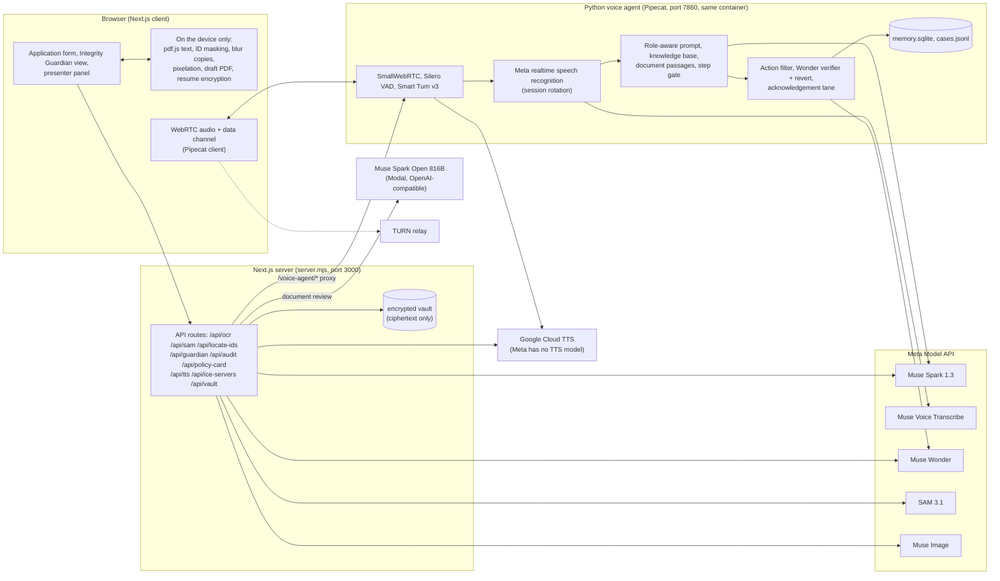

<p align="center"></p>

# CoverPilot

**Two voice agents on one Meta-powered runtime, for a term-life insurance application.**
*Built for the Meta Global AI Developer Hackathon 2026, problem statement "Build for Your World".*

> **Everything here is a demo.** The insurer (NexaSure), its policy documents, UIN, policy numbers and people are fictional. The sample documents are marked as such, the e-signature is a typed name and the payment moves no money. Nothing in this project is an offer of insurance, tax advice or medical advice. The demo build works on the bundled sample documents only (see [Demo build](#demo-build)).

## What it is

Insurance proposals are long, jargon-heavy and easy to sign without understanding. CoverPilot has two agents for that:

1. **The co-browsing agent** talks to the customer in English, Hindi or Marathi and fills the application with them. A second cursor glides to each field, every material answer waits for the customer's Confirm or Undo, every step is checked before the next, and a Muse Wonder verifier checks each action and reverts a rejected one.
2. **Integrity Guardian** is a separate agent (its own prompt, knowledge base, allowed actions and voice) that reviews the proposed policy document. Personal numbers are hidden with black bars in the browser, a Meta model explains the document section by section with page references, plain code compares it with the application and with fixed rules (grace period, suicide clause, free-look, Section 45, nomination), and the customer can ask any question by voice. It flags *possible* issues and suggests questions for the insurer; it never changes the application and never says whether a claim would be paid.

The loop is: **build the application, get the proposed policy, review it independently, fix what it finds, review again.**

## Architecture



More detail, including what runs on the device and what reaches Meta, is in [docs/ARCHITECTURE.md](docs/ARCHITECTURE.md).

## Features and the Meta models behind them

| Feature | Model(s) |
|---|---|
| Live voice in English, Hindi and Marathi with barge-in | **Muse Voice Transcribe** (realtime), **Muse Spark 1.3** (replies), Google Cloud TTS (voice output) |
| Fill the application by voice, with a visible second cursor | **Muse Spark 1.3** (reply plus a typed, allow-listed action) |
| Verify every applied action; revert a rejected one; audit certificate narrative | **Muse Wonder** |
| Read an identity document without ever sending the sharp image | **SAM 3.1** (photo, signature, QR code on blurred copies), **Muse Spark 1.3** (ID number locator on blurred copies, then reading the redacted image) |
| Integrity Guardian: whole-document review | **Muse Spark Open** (816B, served on Modal; or Muse Spark 1.3 via `GUARDIAN_PROVIDER=spark`) |
| Guardian and co-browse questions about the document or the application | **Muse Spark 1.3** with retrieved passages and the live screen state |
| Policy summary card | **Muse Image 1.0** |
| Underwriter hand-off notes for medical or override questions | **Muse Spark 1.3** |

Not used: Muse Glimmer. Muse Code is a coding tool and is not part of the product. Speech output comes from Google Cloud Text-to-Speech because the Meta Model API has no text-to-speech model. There are no simulated or keyword fallbacks: if a Meta or Google call fails, the screen shows the error (the Guardian does not quietly switch from Spark Open to Spark).

## Why this is more than basic RAG

- **It acts, and checks itself.** The agent operates the form through typed, allow-listed actions; a second model verifies each action and a rejected one is reverted; the browser confirms the value actually changed.
- **A human approves what matters.** Income, smoking status and nominees entered by the agent wait for a Confirm or Undo click (a spoken yes does not count), steps cannot be skipped, and the agent never signs, pays or submits.
- **Deterministic checks sit next to the model.** The Guardian's model reads and explains; plain code does the comparisons with the application and the rules, so every finding says which two things disagree and on which page.
- **Privacy by construction.** For identity documents only blurred copies and a redacted image leave the browser. Policy text is masked in the browser before use. Paused proposals are encrypted in the browser, so the server stores ciphertext only.
- **Two agents, not one chatbot with two modes.** Different prompts, knowledge bases, allowed actions, voices and context (the Guardian never gets form screenshots; the co-browsing agent never gets document passages).
- **Documents are untrusted.** Model-read fields are validated field by field, and screen state, documents and excerpts are treated as data in the prompts. A live injection test passed 9 of 9, but the same 9 also passed with the prompt rule removed, so the rule is defence in depth. A short instruction made only of letters can still pass the field shape check.

## Capabilities

| Capability | What it does |
|---|---|
| **Live regional voice agent** | Streaming speech recognition, Silero voice activity detection, Smart Turn v3, barge-in, replies in the language the customer uses, a short parallel acknowledgement so the first words arrive quickly, text fallback in the same box. |
| **Dual-cursor co-browsing** | The agent glides a visible cursor to the exact input, fills it and the browser confirms the value. The customer can pause sharing or revoke control at any time. |
| **Every step validated** | A step can only be left when it is valid (required fields, real date of birth, shares totalling 100%, appointee for a minor, a rider or an explicit "no riders", the Section 45 declaration). The server also drops any agent navigation that would skip an incomplete step. |
| **Confirm or Undo** | Material answers the agent enters show a Confirm / Undo card and block the step until clicked. Values the customer types need no approval. |
| **Documents never overwrite typed answers** | A scanned card fills only empty fields; a difference becomes a card with Keep mine / Use the document's. Step 5 has an application check listing what is still open. |
| **Benefit ladders and nominees** | Critical illness tiers, accidental death options, waiver of premium, hospital cash, up to four nominees, minor appointee, Married Women's Property Act section 6 trust. |
| **Statutory terms drawer** | Eight clauses (Section 45, grace, free-look, suicide, medical disclosure, critical illness periods, claims, revival) opened and highlighted by the agent while it explains them. |
| **Blur-first identity shield** | The sharp original stays in the page. The browser blurs it with its own box filter (identical in every browser) and sends only blurred copies: SAM 3.1 finds photo, signature and QR code (Aadhaar 48 to 54 px wide, PAN 70 to 90 px), Muse Spark finds the ID numbers from layout alone (Aadhaar 48 to 54 px, PAN 85 to 95 px, salary slip 70 to 90 px); boxes are kept only where at least two copies agree, and a missing one fails the request so nothing is read. The browser then pixelates those boxes on the sharp image and only that redacted image is read. Measured with Muse Spark as the reader: it could not read the Aadhaar number at 54 px or below, read part of it at 63 and 72 px and all of it from 80 px; the PAN number was unreadable up to 100 px and leaked at 130 px. Name, date of birth, address and PIN stay readable on the redacted image and do go to Meta, because the form is filled from them. Aadhaar and PAN numbers are never returned, so the customer types them. Tuned on the three sample layouts only; a rare miss is possible; Meta's retention of API inputs is not verified. |
| **Integrity Guardian** | See above. The page opens on a choice: start a new policy or review a policy. It reviews a sample proposed policy or the "proposed policy (draft)" generated from the application (clearly labelled as not an issued policy), explains sections, cites pages, checks the document against the application and the rules, walks through sections by voice, suggests questions for the insurer, tracks review versions (fix, then review again) and produces a downloadable readiness report. A review of the same document and application numbers is reused instead of calling the model again. |
| **Proposed policy that matches the samples** | The draft policy the app generates has the same layout, sections and clause wording as the sample policy PDFs; only the numbers and the customer's details differ. |
| **Pause and resume, also on another device** | Every proposal has a unique code (`NXP-` plus 8 characters). Pausing autosaves in the browser and uploads an encrypted copy made with a secret resume key shown once (PBKDF2 and AES-GCM in the browser; the server never sees the key). Resuming on another device needs the code and the key. Aadhaar, PAN, mobile, signature and payment are never saved. |
| **Knowledge bases from sources** | The co-browsing agent and the Guardian each have their own passages written from IRDAI circulars and regulations, the Insurance Act, the Income-tax Rules 2026 and the PML Rules, with sources and an unverified list in `voice-agent-py/knowledge/SOURCES*.md`. |
| **Underwriter hand-off** | Medical or override questions get a boundary answer and become a case (identity numbers masked) shown on the presenter panel. |
| **Model usage panel** | The presenter panel shows calls, latency and tokens (where the API reports them) per model. No dollar cost is claimed. If the Wonder verifier fails the customer is told the change was not verified. |
| **Tax estimate, audit certificate, policy card, income proof** | Illustrative old-regime tax estimate (not tax advice); a downloadable audit certificate narrated by Muse Wonder; a policy summary card by Muse Image; salary slip reading through the same shield. |
| **Safe by default for a public link** | Rate limits and origin checks on every API route, size caps, strict validation of model output, random customer ids, no key ever sent to the browser. TURN credentials are visible to any visitor, so the limiter only slows abuse. |

## Quick start

### With Docker (one image, both services)

```bash
cp omni_browse/.env.example omni_browse/.env.local      # then fill in META_MODEL_API_KEY and GOOGLE_TTS_API_KEY (and TURN_* on macOS or behind NAT)

docker build -t coverpilot:local .
docker run -d --name coverpilot --restart unless-stopped -p 3000:3000 \
  -v "$PWD/omni_browse/.env.local:/app/omni_browse/.env.local:ro" \
  -v coverpilot-data:/app/voice-agent-py/data \
  coverpilot:local
# open http://localhost:3000   (presenter view: http://localhost:3000/presenter)
```

- Keys are never baked into the image: mount the env file as above (or pass plain `-e` variables). Do not use `--env-file` with quoted values, because Docker keeps the quotes.
- WebRTC audio is UDP. Behind NAT, a cloud firewall or Docker Desktop on macOS, set `TURN_URLS`, `TURN_USERNAME` and `TURN_CREDENTIAL` so audio relays through TURN. On Linux you can use `--network host` instead.
- The data volume holds `memory.sqlite`, `cases.jsonl` and the encrypted vault.
- The same `Dockerfile` builds for arm64 and amd64; for another architecture use `docker build --platform linux/amd64 ...`.

### Local development

```bash
cd voice-agent-py && uv sync && cd ..                    # Python 3.12 environment for the agent
cd omni_browse && pnpm install && cd ..
./run-local.sh                                           # agent on :7860, app on http://localhost:3004
```

### Try the demo

Open the app, pick **Start a new policy**, accept the session and speak. Use the sample buttons for the PAN card, Aadhaar card and salary slip. At step 5 download the proposed policy (draft) or press **Review it with Integrity Guardian**, or pick **Review a policy** on the opening screen and load **Sample proposed policy (with issues)** from `omni_browse/public/samples/`. The 3-minute walkthrough is in [docs/DEMO_SCRIPT.md](docs/DEMO_SCRIPT.md).

### Demo build

The image works on the bundled sample documents only. The controls for picking your own ID image or policy PDF are implemented and tested but hidden unless the app is built with `NEXT_PUBLIC_ALLOW_OWN_FILES=true`.

### Deploy to a public host

`deploy/deploy.sh ubuntu@<public-ip> <public-ip>` builds the image, sends it over SSH and starts CoverPilot behind Caddy with automatic HTTPS. Steps, ports and caveats are in [docs/DEPLOY.md](docs/DEPLOY.md).

## Testing

- **Unit tests:** `cd voice-agent-py && uv run --with pytest python -m pytest -q tests/ --ignore=tests/harness_offline.py --ignore=tests/integration` and `cd omni_browse && pnpm test:unit`.
- **Live injection test (uses the Meta API key):** `cd voice-agent-py && uv run --with pytest python -m pytest -q tests/integration -s`.
- **Acceptance run:** `scripts/run-acceptance.sh` runs the Playwright suite in `omni_browse/e2e` against the Docker image on :3000: the 13-item acceptance scenario, a prompt-injection check, the Integrity Guardian review of the planted-issues sample, the two-agent check and cross-browser resume, plus a failure check (a failing model call changes no data) against a second instance started with an invalid key. `BROWSER=firefox scripts/run-acceptance.sh` runs it in Firefox. It talks to the live Meta models and types questions into the same pipeline voice uses. Reports are written to `docs/acceptance-report-<browser>.md`; the latest runs are in [Chromium](docs/acceptance-report-chromium.md) and [Firefox](docs/acceptance-report-firefox.md).

## Built during the hackathon

<!-- OWNER: confirm this disclosure before submitting -->
**Starting point.** A small prototype from 26 Oct, the kickoff day and before the building period: 14 commits from 26 Oct 19:01 to 27 Oct 00:29 (IST) that made a single-page Next.js co-browsing proposal form, with voice through REST endpoints and browser speech, benefit ladders, a nominee and trust section, a terms drawer and several voice personas. **Everything below was built from 27 Oct.** The first commit of that work is the Python Pipecat agent on 27 Oct 19:39 IST, and the document, identity-shield, verifier and policy-card API routes were first committed in the same batch, so the history shows them arriving together on that evening. The commit history was squashed into a single commit for this public repository, so those 14 prototype commits are described here instead of being listed, and the notes written during the prototype (design notes drafted as AI chat) are not included.

Built from 27 Oct:
- A **Python Pipecat voice agent** with SmallWebRTC, Silero VAD and Smart Turn v3, replacing the prototype's REST voice endpoints and browser speech, with a role-aware prompt and knowledge base per turn.
- **Meta realtime speech recognition** as a Pipecat service, with session rotation before Meta's 60-minute limit and a lock so reconnects cannot leak a second session.
- **Muse Wonder action verification with revert**, an "ask" verdict, an acknowledgement lane for fast first words, and a server-side step check.
- **Step gate, Confirm / Undo approvals, the discrepancy card** and the application check at step 5.
- The **blur-first identity shield** (SAM 3.1 plus a Muse Spark ID locator, a browser-independent blur, measured thresholds) and the sample documents.
- **Integrity Guardian**: the document viewer with redaction, the review with Muse Spark Open (or Spark), the deterministic checks, voice walkthrough, readiness report, review history, and a draft policy generated to match the sample policy PDFs.
- **Two agents** with separate prompts, knowledge bases, actions and voices.
- **Encrypted cross-browser resume** and pause.
- **Knowledge bases written from IRDAI and statute sources** (about 230 passages, with a sources and unverified list).
- **Rate limits, validation and the fixes from a code review**; the **Playwright acceptance suite** and unit tests; the **Docker image and deploy kit**; the presenter panel and demo script.

The detailed log is in [TODAYS_WORK_HISTORY_AND_NEXT_STEPS.md](TODAYS_WORK_HISTORY_AND_NEXT_STEPS.md).

## Honest limits

- A demo on fictional documents. The identity shield was tuned on three sample layouts and has not been tried on real cards; PDFs of ID cards are not supported.
- Meta's retention of API inputs is not verified. Name, date of birth, address and PIN on a redacted document, masked policy text and form state do go to Meta.
- Capacity is unmeasured (one container, one voice pipeline per session).
- A few regulatory points are marked unverified in `voice-agent-py/knowledge/SOURCES-*.md`, and the passages tell the customer to confirm them with the insurer.
- The Guardian explains contract wording and flags possible issues. It does not predict claim decisions and is not legal, tax or financial advice.

## License

MIT. See [LICENSE](LICENSE).
