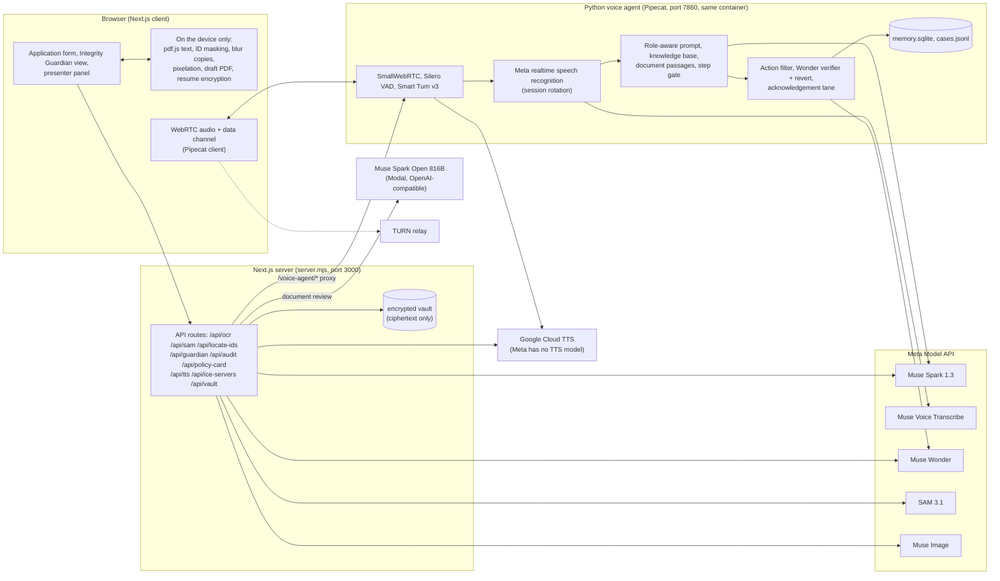

# Architecture

CoverPilot is two agents on one Meta-powered runtime, for a fictional insurer (NexaSure) and a term-life proposal:

- the **co-browsing agent** talks to the customer and fills the application with them, with a visible second cursor;
- **Integrity Guardian** is a separate agent that reviews the proposed policy document, explains it with page references and flags possible issues.

They share the browser, the voice pipeline and the document pipeline, and differ in system prompt, knowledge base, allowed actions and voice. The browser tells the server which one is active (`set_mode`), and the server switches prompt, knowledge base, voice and context at once.

## What runs where

**In the browser (nothing here leaves the device unless stated):**
- Reading a policy PDF with pdf.js and masking Aadhaar, PAN, mobile, account and email patterns before the text is used anywhere.
- For identity documents: the sharp image stays in the page. The browser blurs it with its own box filter (the same result in every browser), sends only the blurred copies, then pixelates the located regions on the sharp image and sends only that redacted image to be read.
- The "proposed policy (draft)" PDF is generated with jsPDF from the application.
- Pausing a proposal encrypts it with a resume key (PBKDF2-SHA256, AES-GCM) and uploads only the ciphertext.

**Next.js server:** serves the app, owns every Meta and Google API key (keys never reach the browser), validates and rate-limits each API route, proxies `/voice-agent/*` to the Python agent, and stores encrypted paused proposals.

**Python voice agent (Pipecat):** one pipeline per session:
1. SmallWebRTC transport, Silero voice activity detection and Smart Turn v3 decide when the customer has finished.
2. Meta realtime speech recognition streams the microphone (the session is reopened between utterances before Meta's 60-minute limit).
3. A processor builds each turn's context for the active role: system prompt, role-specific knowledge base (BM25 with insurance synonyms), live screen state, and, for the Guardian only, passages from the customer's document. Only the co-browsing agent gets form screenshots.
4. Muse Spark answers; the reply is spoken and ends with an `<<ACTION>>` JSON that a filter removes from the speech and turns into a typed, allow-listed form action.
5. Muse Wonder verifies each applied action asynchronously (approve, amend, reject, ask); a rejected action is reverted. Guarded steps and approvals are enforced in the browser, and the server drops any navigation that would skip an incomplete step.
6. Replies are synthesised sentence by sentence by Google Cloud TTS.

## Models by role

| Model | Role |
|---|---|
| Muse Voice Transcribe | Realtime speech to text |
| Muse Spark 1.3 | Agent replies and actions (both agents), document reading, ID number locator, underwriter case notes |
| Muse Wonder 1.0 | Verifies agent actions; writes the audit certificate narrative |
| SAM 3.1 | Finds photo, signature and QR code on blurred copies of an ID card |
| Muse Image 1.0 | Policy summary card |
| Muse Spark Open (816B, on Modal) | The Integrity Guardian's whole-document review, one call per review |
| Google Cloud TTS (not Meta) | Spoken replies |
| Not used | Muse Glimmer. Muse Code is a coding tool and not part of the product. |

## Two agents, side by side

| | Co-browsing agent | Integrity Guardian |
|---|---|---|
| Prompt | Fills the application, step gate, approvals | Reviews a document, never changes the application |
| Actions it can emit | fill, select, ladder, cover, nominate, navigate, ui, escalate | walk sections, navigate (after the customer agrees), hand back to co-browsing, escalate |
| Knowledge base | shared files plus `cobrowse-*` | shared policy files plus `guardian-*` |
| Document passages | no | yes (best few passages per question, with the page) |
| Form screenshots | yes | no |
| Voice | the customer's chosen voice | a different voice |

## Integrity Guardian

1. The customer picks the proposed policy (or the draft generated from their application). The PDF text is read and masked in the browser and shown with black bars over personal numbers.
2. One model call (Spark Open, or Spark if configured) returns sections with summaries, coverage, exclusions, questions to ask the insurer and the facts it found, each with a page. The result is validated field by field and kept in session storage so an identical review makes no second call.
3. Plain code compares the facts with the application (cover, premium, term, riders, nominees) and with fixed rules (grace period, suicide clause, free-look, Section 45, nomination). Findings are worded as possible issues with a page and, where it applies, a button back to the right application step. The model never makes these comparisons.
4. The customer asks questions by voice or text; the Guardian answers from the document passages, says when the document does not say, and never predicts a claim decision.
5. A readiness report lists sections reviewed, issues still open and questions not yet asked. The customer decides.

## Data and privacy

- **In the data volume** (`/app/voice-agent-py/data`): `memory.sqlite` (facts remembered per customer id, a random UUID the browser makes), `cases.jsonl` (underwriter hand-offs with identity numbers masked) and `vault/` (encrypted paused proposals, readable only with the resume key).
- **To Meta:** blurred copies of ID documents, the redacted document image (name, date of birth, address and PIN are readable on it), masked policy text, form state as JSON, and screenshots of the form with identity-number fields left out. Meta's retention of API inputs is not verified.
- **Never saved or sent:** Aadhaar, PAN and mobile numbers typed by the customer, the e-signature and the payment.
- This is a demo with fictional documents and a fictional insurer; the e-sign is a typed name and the payment is not real.
